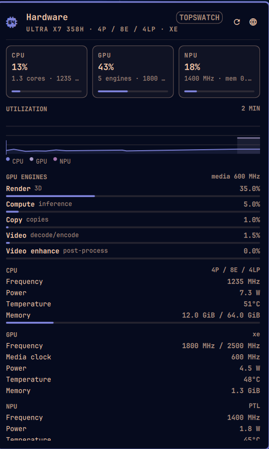

# Hardware Monitor

A native Omarchy bar widget and panel for CPU, GPU, and NPU utilization, built
for Panther Lake (Core Ultra Series 3) laptops.



The plugin owns the presentation. Hardware telemetry comes from
[TopsWatch](https://github.com/scottmbaker/topswatch), a small Go daemon that
reads Intel PMT, RAPL, the xe GPU PMU, and sysfs. The collector is deliberately
kept behind `SourceTopsWatch.qml` / `Metrics.qml`, so a future local/sysfs
source can be added without touching the panel.

## What it shows

| Area | Bar | Panel |
|---|---|---|
| CPU | utilization | utilization, per-type topology, frequency, power, temperature, memory |
| GPU | utilization | per-engine busy (render, compute, copy, video, video enhance), media clock, frequency, power, memory |
| NPU | utilization | frequency, power, temperature, DDR bandwidth, memory, tile config |
| Power | package watts in tooltip | RAPL domains, battery state |
| History | — | 2-minute CPU/GPU/NPU utilization chart |
| Health | stale/offline tooltip | TopsWatch warnings and a stale/offline banner |

The bar defaults to `C12 G08 N00`-style segments. Right-click cycles
`All → CPU → GPU → NPU → Worst → Icon`; left-click opens the panel;
middle-click opens btop.

## Requirements

- Omarchy 4.x (Quickshell shell plugins)
- TopsWatch for GPU utilization, per-engine breakdown, power, and NPU PMT
  metrics

Without TopsWatch the widget still renders, but only shows dashes. A local
sysfs fallback (CPU/NPU utilization and a coarse GPU activity number) is a
planned second source, not part of v0.1.

## Install

### 1. TopsWatch

From the dotfiles repository root:

```bash
./scripts/install-topswatch.sh
```

From a standalone copy of this plugin:

```bash
./install/install-topswatch.sh
```

The installer:

- builds a pinned TopsWatch revision (no tagged releases exist yet)
- installs `/usr/local/bin/topswatch`, `/etc/topswatch.yaml`, and a systemd unit
- binds the HTTP API to `127.0.0.1:9876` only
- runs the daemon as a dynamic user with `CAP_PERFMON`,
  `CAP_DAC_READ_SEARCH`, and `CAP_SYS_PTRACE` instead of full root
- verifies which metrics the API publishes

If GPU utilization or NPU PMT metrics are missing, rerun with `--root`:

```bash
./install/install-topswatch.sh --root
```

The service is independent of the plugin:

```bash
systemctl status topswatch
journalctl -u topswatch -f
```

### 2. Plugin

If you use this dotfiles repo, stow the plugin package and rescan:

```bash
stow --restow --target="$HOME" --dir=dotfiles omarchy-plugins
omarchy-shell shell rescanPlugins
omarchy plugin enable mark.hardware-monitor --section right --after omarchy.agents
```

### Publishing as a standalone plugin

The plugin directory is self-contained: `manifest.json`, QML, tests, docs, and
the TopsWatch installer all live under it. To publish it as an Omarchy plugin
repository, copy the directory to the root of a new repository:

```bash
mkdir -p ~/projects/omarchy-hardware-monitor
cp -a dotfiles/omarchy-plugins/.config/omarchy/plugins/mark.hardware-monitor/. \
      ~/projects/omarchy-hardware-monitor/
cd ~/projects/omarchy-hardware-monitor
git init
git add .
git commit -m "Hardware Monitor: CPU/GPU/NPU bar widget for Omarchy"
```

Then users can install it with the normal plugin flow:

```bash
omarchy plugin add <repository-url> --enable
```

The plugin installs and renders without the installer; TopsWatch unlocks the
full metric set.

## Use

Left-click the bar widget to open or close the panel. Right-click cycles the
bar display; middle-click opens btop. While the panel is open, `R` refreshes,
`E` toggles the GPU engine section, `W` opens the TopsWatch web UI, `B` opens
btop, and `Esc` closes.

The plugin also registers its own IPC target, so a keybinding can open it
without touching the bar:

```bash
quickshell ipc -p /usr/share/omarchy/shell call mark.hardware-monitor toggle
```

For a Lua Hyprland config:

```lua
o.bind("SUPER + ALT + H", "Hardware monitor",
       "quickshell ipc -p /usr/share/omarchy/shell call mark.hardware-monitor toggle")
```

## Settings

Settings live inline on the plugin's `shell.json` entry and can be edited in
the Omarchy settings UI:

| Key | Default | Meaning |
|---|---|---|
| `barMode` | `All` | `All`, `CPU`, `GPU`, `NPU`, `Worst`, `Icon` |
| `endpoint` | `http://127.0.0.1:9876` | TopsWatch base URL |
| `closedRefreshSec` | `5` | Poll interval while the panel is closed |
| `openRefreshSec` | `1` | Poll interval while the panel is open |
| `warnPercent` | `80` | Warning tint threshold |
| `critPercent` | `95` | Critical tint threshold |
| `showEngines` | `On` | Show the GPU engine breakdown |
| `showPower` | `On` | Show the power section |
| `showChart` | `On` | Show the utilization history chart |

## Security

TopsWatch's API has no authentication. The unit binds it to loopback and
systemd's `IPAddressAllow=localhost` / `IPAddressDeny=any` keeps it there.
If you point `endpoint` at another machine, put it behind an SSH tunnel or an
authenticated reverse proxy.

The default unit runs TopsWatch as a `DynamicUser` with only the capabilities
it needs. `--root` is available as a fallback but is broader than necessary.

TopsWatch has no license file at the time of writing. This plugin only talks to
its HTTP API and does not vendor or redistribute its code. Build it from source
locally.

## Development

The parsing/formatting layer is pure JavaScript and testable without Quickshell:

```bash
node --test tests/model.test.js
```

`Model.js` normalizes the TopsWatch sample into a stable snapshot. To add a
second source:

1. Add `SourceLocal.qml` that emits the same TopsWatch-shaped sample.
2. Select it in `Metrics.qml` via `sourceKind`.
3. Keep `Model.normalizeSample()` as the single schema boundary.

## Tested on

- Intel Core Ultra X7 358H (Panther Lake), 4P / 8E / 4LP
- kernel `7.2.8-9-omarchy`, `xe` GPU driver, `intel_vpu` NPU driver
- Omarchy 4.0 alpha, Quickshell 0.3.2
- TopsWatch commit `bfd355cd` (per-engine GPU support)

## License

This plugin is licensed under the [Apache License, Version 2.0](LICENSE).

### Attribution

`StatTile.qml` and `Sparkline.qml` are adapted from
[Harshith292002/omarchy-system-monitor](https://github.com/Harshith292002/omarchy-system-monitor),
Copyright (c) 2026 Harshith Chennupati, and retain that project's MIT license.
The MIT text is included in
[LICENSES/MIT-omarchy-system-monitor.txt](LICENSES/MIT-omarchy-system-monitor.txt).
The hardware telemetry and metric semantics come from
[scottmbaker/topswatch](https://github.com/scottmbaker/topswatch); TopsWatch is
a separate project and is not redistributed here.
